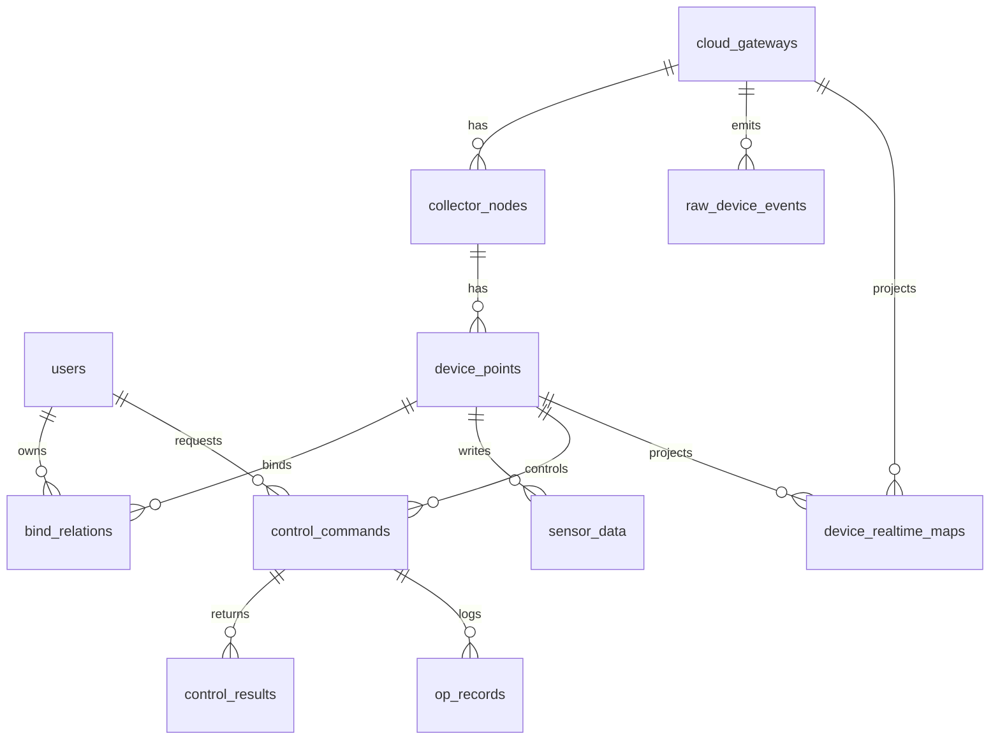

# 涅凰智农 V1 数据模型说明

> 注意：本文记录领域建模思路。最终物理表名、字段类型、字段命名、索引和写库 cycle 以 `schema/mysql/001_nehuang_v1.sql`、`schema/mysql/002_device_node_point_model.sql` 与 `docs/table_structure_v1.md` 为准。

## 1. 建模原则

甲方给的字段表不是最终平台模型，但它定义了验收必须保留的业务字段。V1 采用“保留核心表 + 扩展平台表”的方式。

保留：

- 表名保留：`cloud_gateway`、`bind_relation`、`device_realtime_map`、`sensor_data`、`op_record`。
- 字段名保留：甲方字段表中的字段不删除、不改名。
- 业务含义保留：`cloud_gateway + freq + devid` 是定位采集执行器的核心组合。

扩展：

- 用 `users` 承接管理员和微信农户。
- 用 `collector_nodes` 承接采集执行器节点身份。
- 用 `device_points` 承接节点下的温度、墒情、限位、继电器、水泵、风机等功能点。
- 用 `raw_device_events` 承接协议未定稿时的原始数据。
- 用 `control_commands/control_results` 承接控制闭环。
- 用 `protocol_command_templates` 承接继电器和轮询命令模板。

## 2. 核心实体关系



## 2.1 已确认的硬件身份规则

硬件侧已确认：

- `freq`（频点）和 `devid`（设备 ID）是在出厂或施工前通过 PC 写入设备的固定身份信息。
- 正常使用过程中，`freq + devid` 不会随着农户、安装位置、棚号或业务配置变化而变化。
- 如果设备回收后重新施工，硬件负责人可能重新写入频点和 ID；否则默认长期不变。
- 在同一个云边/LoRa 通信接入单元下，`freq + devid` 必须唯一；如果出现重复，上报和控制会发生错乱。
- 不同云边设备下允许出现相同的 `freq + devid`，因为服务端以 `cloud_gateway + freq + devid` 作为完整身份。
- 频点范围按硬件口径为 `1~127`，设备 ID 范围为 `0~65535`。旧页面存在 `0~127` 下拉，V1 先按硬件最终协议和实际数据为准。

服务端职责：

- 不负责给硬件分配频点和 ID。
- 不负责校验施工现场是否有重复设备；这是硬件施工和运维流程负责的事项。
- 服务端需要在同一个云边设备下对 `frequency + device_external_id` 建唯一约束，避免业务层重复建档。
- 农户、棚号、基地、区域、设备名称、备注、绑定关系、控制策略、权限、自动模式都属于业务数据，可以在服务端修改，不需要改硬件固件。

## 2.2 V1 当前抽象修正

为了避免把“一台采集执行器节点”和“节点下面的功能点/通道”混在一起，当前模型已经拆成：

```text
cloud_gateways
  -> collector_nodes
  -> device_points
```

含义：

- `cloud_gateways`：云边/LoRa 通信接入单元。注册包里的 `FP_` 标识进入这里。
- `collector_nodes`：采集执行器节点。唯一身份是 `gateway_id + frequency + device_external_id`。
- `device_points`：采集执行器节点下的功能点/通道，例如温度、墒情、限位、继电器、水泵、风机。
- `device_realtime_maps`：保留甲方旧字段和验收语义，后续作为兼容投影，不再作为主抽象。

对页面和接口的影响：

- 农户看到的一行设备数据，优先对应一个 `device_points`。
- 管理员绑定用户权限时，优先绑定到 `point_id`。
- 曲线数据按 `point_id` 查询。
- 控制命令按 `point_id` 落库和校验权限。
- 如果一个采集执行器节点下面有多个功能点，服务端不再需要创建多条“重复节点”，只需要在同一个 `node_id` 下创建多个 `device_points`。

## 2.3 容量软约束

硬件侧补充的现场经验：

- 一个云边/LoRa 通信接入单元并不是实际使用全部 `1~127` 频点。
- 常规设备实操一般只启用 4 个频点，少数型号最多 6 个频点。
- 采集周期默认约 300 秒，健康工作节奏下大部分时间应保持空闲冗余，避免空中撞包、炸包。
- 一个云边设备下理论容量很大，但现场建议严格控制在 100 个采集点以下。
- 如果一个农户、合作社或基地超过 100 个采集点，硬件施工侧应拆成两组或多组云边设备。

服务端处理原则：

- V1 不把频点数量和采集点数量做成强制拦截规则。
- V1 只按 `gateway_id + frequency + device_external_id` 建立 `collector_nodes`，再按 `node_id + function_type + channel_no` 建立 `device_points`。
- 容量规划属于硬件施工和运维流程；服务端可以在后台做统计和提示。
- 后续如需要，可在 `cloud_gateways.extra` 或独立配置表中记录设备型号、建议频点上限、建议点位上限等容量参数。

对服务端数据架构的影响：

- 不改变硬件主身份：完整身份仍然是 `gateway_id + frequency + device_external_id`。
- 当前已经新增 `collector_nodes` 和 `device_points`，用于避免节点和功能点混用。
- `device_realtime_maps` 保留为兼容投影，不再承担唯一主模型。
- 后续如果甲方要后台容量提示，可以按 `gateway_id` 聚合统计频点数、节点数和功能点数。

## 3. 表职责

### 3.1 `cloud_gateway`

表示 E90/FP 云边设备。

当前 `devices.json` 示例：

```json
{
  "id": "TEST_ADMIN_001",
  "name": "FP_TEST_ADMIN_001",
  "ip": "123.190.0.47",
  "port": 40000,
  "online": true,
  "last_time": "2026-06-28 14:04:47",
  "last_data": ""
}
```

写入规则：

- `name` -> `dev_name`
- 去掉 `FP_` 后 -> `dev_id`
- `ip` -> `ip`
- `port` -> `port`
- `online` -> `online`
- `last_time` -> `last_heartbeat`

`dev_sn` 当前旧 Gateway 无法提供，V1 暂时允许空字符串，等心跳协议明确后再写真实硬件序列号。

### 3.2 `collector_nodes`

表示 E220/485/TTL 后端挂载的采集执行器节点。

唯一定位：

```text
gateway_id + frequency + device_external_id
```

这对应硬件侧确认的“同一云边设备下 `freq + devid` 唯一”。`shed_no`、农户、设备名称、备注都不参与硬件身份，只作为业务标签或绑定关系。

字段职责：

- `frequency`：硬件通信频点，不是 0/1 开关量。
- `device_external_id`：硬件写入的设备 ID。
- `shed_no/base_name/area_name`：用户或管理员用来落位和区分片区的业务标签。
- `online_status/last_report_at_ms`：节点级在线和上报状态。

### 3.3 `device_points`

表示采集执行器节点下的功能点/通道。

页面字段：

- 棚号：`shed_no`
- 设备序号：`collector_no`
- 频点：`freq`
- ID：`devid`
- 功能：`function_type`
- 通道：`channel_no`
- 最佳范围：`best_min`、`best_max`
- 单位：`unit`
- 实际值：`real_temp` / `real_value`
- 模式：`run_mode`
- 操作：`rel1`、`rel2`、`operation_state`

兼容说明：

`real_temp` 是甲方字段名，必须保留。为了支持墒情、限位等非温度数据，V1 新增 `real_value` 作为通用值；温度场景下两个字段保持一致。

### 3.4 `device_realtime_map`

表示甲方旧字段兼容投影。

用途：

- 保留甲方字段含义，方便验收和兼容旧页面概念。
- 可由 `device_points` 同步生成或更新。
- 新服务端业务主流程不直接依赖它。

### 3.5 `bind_relation`

表示农户与设备的可见/可操作关系。

甲方逻辑中，用户不是只绑定 Gateway，而是绑定到：

```text
农户 + 云边设备 + 采集执行器节点 + 功能点
```

这决定了 C 端查询设备时不能只按 `dev_name` 过滤，必须按 `user_id` 查绑定关系，再联合 `device_points` 和 `collector_nodes` 获取实时状态和业务位置。

### 3.6 `sensor_data`

表示历史采集数据。

写入规则：

- 每次工作包解析出有效模拟量后写入。
- 同步更新 `device_points.real_temp/real_value`。
- 如需要兼容旧页面，同步更新 `device_realtime_map.real_temp/real_value`。
- `poll_interval` 保存采集周期，方便曲线渲染。

V1 不直接做报表中心，但可以保留按月汇总和清理 30 天前数据的任务接口。

### 3.7 `op_record`

表示人工操作记录。

写入规则：

- `run_mode=manu` 时，B 端和 C 端控制动作写入。
- `run_mode=auto` 时，自动控制动作不作为人工操作写入本表，应写入 `control_commands`，并标记 `command_source=auto`。

### 3.8 `raw_device_events`

表示所有原始设备输入。

用途：

- 协议未定稿时保证不丢数据。
- 解析失败可重试。
- 排查设备回包和现场问题。

事件类型：

- `register`
- `heartbeat`
- `work`
- `control_result`
- `json_snapshot`

### 3.9 `control_commands`

表示服务端产生的控制命令。

命令状态：

- `created`：已创建，未下发。
- `sent`：已调用 Gateway 下发。
- `ack`：收到设备确认。
- `succeeded`：执行成功。
- `failed`：执行失败。
- `timeout`：超时未确认。

### 3.10 `control_results`

表示设备执行结果回传。

一个命令可以对应多条结果，因为设备可能先 ACK，再返回最终执行状态。

## 4. 旧字段冲突处理

旧代码里同时出现了两套字段：

- 甲方/当前 SQL：`bind_usr_name`、`devid`
- 历史 Python：`farmer`、`devname`

V1 以甲方字段表为准：

- 农户名称使用 `bind_usr_name`。
- 云边设备使用 `cloud_gateway.id/dev_name`。
- 采集执行器使用 `freq + devid`。
- `username` 作为兼容字段保留，但不作为主业务字段。
- `farmer/devname` 不进入 V1 正式 schema。

## 5. API 查询口径

### 5.1 管理员视角

管理员能看全量：

- 全部用户。
- 全部 Gateway。
- 全部采集执行器。
- 全部绑定关系。
- 全部实时数据。
- 全部控制命令和操作日志。

### 5.2 微信用户视角

微信用户只能看自己绑定的数据：

```sql
SELECT ...
FROM bind_relations b
JOIN device_points p ON p.point_id = b.point_id
JOIN collector_nodes n ON n.node_id = p.node_id
JOIN cloud_gateways g ON g.gateway_id = n.gateway_id
WHERE b.user_id = ?
  AND b.bind_status = 1
  AND p.point_status = 1
  AND n.node_status = 1;
```

控制接口也必须先按同样口径校验权限，再生成 `control_commands`。

## 6. Gateway / Adapter 同步口径

当前正式路径：

```text
硬件网关 TCP client
  -> Go gateway-adapter
  -> raw frame journal
  -> 已识别 register/heartbeat 转发到 /api/v1/adapter/device-events
  -> nehuang-server
  -> MySQL
```

当前原则：

- `devices.json` 只作为旧 Python 网关的历史缓存和联调参考，不再作为当前正式事实来源。
- Go `gateway-adapter` 收到任何 bytes 后先写 raw frame journal。
- 已确认的注册/心跳事件由 Adapter 转成 HTTP envelope 发给 Go 服务。
- 工作包、告警包、控制结果在协议样例未冻结前先保留 raw，不写死字段偏移。
- 后续 parser 可以从 raw journal 回放验证，再把解析结果写入 `raw_device_events`、`sensor_data`、`device_points` 和 `device_realtime_maps`。

## 7. 已确认的服务端架构方案

V1 服务端按“设备接入、数据固化、业务 API”分层设计，目标是让硬件数据链路和后台/小程序业务迭代解耦。

### 7.1 设备数据链路

```text
采集执行器节点
  -> 云边/LoRa 通信接入单元
  -> Go gateway-adapter
  -> raw frame journal
  -> Device Event / Parser
  -> raw_device_events
  -> collector_nodes / device_points / sensor_data
  -> MySQL
```

边界：

- 云边设备和 LoRa 汇聚按一个通信接入单元理解，服务端不拆内部硬件层级。
- Go `gateway-adapter` 负责设备 TCP 连接、注册、心跳、工作包接收和原始包留痕。
- 协议解析层负责把 raw bytes 转换为服务端可识别的数据：`gateway_id + frequency + device_external_id + function_type + channel_no + value/status`。
- 原始数据优先进入 raw journal；可识别 envelope 进入 `raw_device_events`，解析成功后再更新实时表和历史表。
- 业务服务不直接处理 TCP 和十六进制协议。

### 7.2 客户端业务链路

```text
微信小程序 / 管理后台
  -> HTTPS REST API
  -> User / Device / Control / Admin Service
  -> Repository
  -> MySQL
```

边界：

- 小程序和后台不直接读取 `devices.json`。
- 小程序和后台看到的数据都来自 MySQL。
- 微信登录、用户设备列表、实时数据、历史数据、设备控制都属于 Go HTTP API 的职责。
- 硬件侧不需要理解小程序如何进入服务端，只需要保证设备数据上行和控制结果回传。

### 7.3 数据事实来源

MySQL 是业务唯一事实来源：

- `cloud_gateways` 记录云边接入设备在线状态。
- `collector_nodes` 记录采集执行器节点身份和业务落位。
- `device_points` 记录功能点实时状态、阈值、模式、继电器和轮询配置。
- `device_realtime_maps` 作为甲方旧字段兼容投影。
- `sensor_data` 记录按功能点沉淀的历史曲线。
- `raw_device_events` 记录原始设备输入，便于追溯和重放解析。
- `control_commands/control_results` 记录控制闭环。
- `bind_relations` 记录农户和设备网关/功能点的可见/可操作关系。当前默认是农户绑定设备网关，旧功能点绑定保留兼容。

## 8. 已确认的上线与迭代方案

甲方关注后续新增功能时设备数据是否会丢、服务是否会整体不可用。V1 的回答口径如下。

### 8.1 分层保障思路

```text
设备接入层稳定接收
  -> 数据处理层解析校验
  -> 数据库固化
  -> 业务 API 查询和控制
  -> 小程序 / 后台展示
```

保障原则：

- 设备接入层和业务 API 层分离，后台或小程序新增功能不应影响 TCP 数据接收。
- 设备原始数据先落 `raw_device_events`，再做业务解析，降低协议变化或业务逻辑调整造成的数据丢失风险。
- 已经写入 MySQL 的数据不依赖设备长连接和页面状态。
- 后台和小程序只查询数据库中的固化数据。
- 新增页面、新增曲线、新增配置优先通过新增接口或兼容旧接口扩展，不破坏已有接口。

### 8.2 单机低停机发布方案

一期即使只有一台服务器，也可以按低停机方式部署业务 API：

```text
Nginx
  -> Go API instance A
  -> Go API instance B
```

发布步骤：

1. Nginx 同时代理两个 Go API 实例。
2. 发布新版本时，先从 Nginx 流量中摘掉实例 A。
3. 升级实例 A，并执行健康检查。
4. 实例 A 健康检查通过后切回流量。
5. 再摘掉实例 B，重复升级和健康检查。
6. 两个实例都升级完成后结束发布。

效果：

- 普通后台和小程序接口可以做到秒级切换。
- 新增业务功能不需要停止设备 TCP 接入层。
- 如果新版本异常，可以切回旧实例或旧版本二进制。

### 8.3 必须明确的限制

单机方案不能承诺大型集群意义上的绝对零中断：

- 服务器本身是单点。
- MySQL 是单点。
- 当前 TCP Gateway 设备长连接是单点。
- 如果需要重启 TCP Gateway，设备连接可能短暂断开，需要依赖设备重连和心跳恢复。

一期目标是：

- 设备数据优先落库。
- 业务 API 低停机发布。
- 接口向后兼容。
- 异常可回滚、可恢复、可追溯。

后续如果设备规模扩大或甲方要求更高可用性，再升级为多机部署、独立负载均衡、数据库备份/主从和 Gateway 高可用。

### 8.4 小程序迭代兼容

微信小程序页面是客户端静态资源，用户侧可能存在新旧页面并存：

- 老页面继续调用旧接口。
- 新页面使用新增接口。
- 服务端保留旧接口兼容，避免新页面发布影响已有用户。
- 新增曲线模块、配置模块、控制模块时，优先新增 API 或新增字段，不直接破坏旧响应结构。

## 9. 与甲方沟通的固定口径

可以按以下方式对外说明：

```text
设备侧负责提供稳定身份和实时数据。频点和设备 ID 是硬件写入的固定身份，在同一云边设备下必须唯一。

服务端负责维护设备和业务之间的关系，包括农户、棚号、基地、区域、名称、备注、权限、控制策略和自动模式。这些业务配置可以在服务端修改，不需要修改设备固件。

系统上线后会按设备接入、数据处理、数据库、业务 API 分层。设备数据优先固化到数据库，后台和小程序从数据库读取。后续新增页面或功能时，会尽量通过接口兼容和滚动发布降低影响。

一期单机部署可以做到低停机和可回滚，但不承诺大型集群意义上的绝对零中断。后续如果规模扩大，再升级多机和高可用。
```
